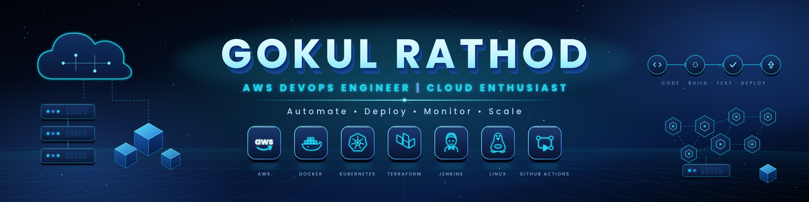
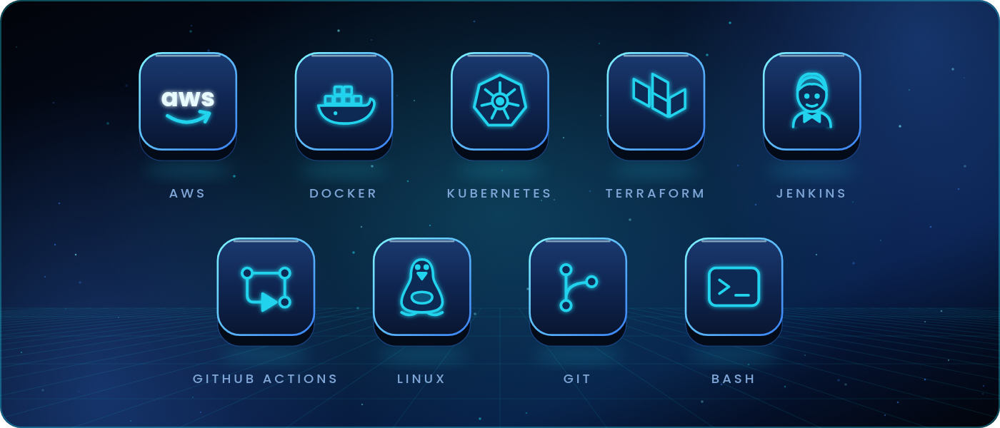
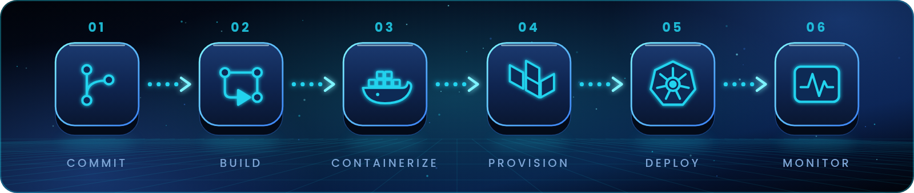

<p align="center">
  
</p>

<p align="center">
  <a href="https://github.com/g2rindian2005-cyber"></a>
</p>

<p align="center">
  
  
</p>

<br/>

<p align="center"></p>

```bash
$ whoami
gokul-rathod

$ cat profile.yaml
role:        Aspiring AWS DevOps / Cloud Engineer
education:   BCA Graduate 2026
focus:       [AWS, Docker, Kubernetes, Linux, GitHub Actions, CI/CD]
learning:    [Terraform, Kubernetes, Monitoring, Cloud Architecture]
building:    CI/CD pipelines & cloud projects
goal:        Automate everything. Ship reliably. Scale confidently.
open_to:     Entry-level DevOps / Cloud Engineer roles & internships
```

<p align="center"></p>

<p align="center">
  
</p>

<p align="center"></p>

<p align="center">
  
</p>

<p align="center"></p>

<p align="center">
  
  
</p>

<p align="center">
  
</p>

<p align="center">
  
</p>

<p align="center">
  
</p>

<p align="center"></p>

<table align="center">
  <tr>
    <td><a href="https://github.com/g2rindian2005-cyber/terraform-practice"></a></td>
    <td><a href="https://github.com/g2rindian2005-cyber/food-App"></a></td>
  </tr>
  <tr>
    <td><a href="https://github.com/g2rindian2005-cyber/git-stash-2"></a></td>
    <td><a href="https://github.com/g2rindian2005-cyber/fullstack-authors-books-application"></a></td>
  </tr>
</table>

<p align="center"></p>

<p align="center">
  <a href="https://www.linkedin.com/in/YOUR-LINKEDIN-ID"></a>
  <a href="mailto:YOUR-EMAIL@gmail.com"></a>
  <a href="https://github.com/g2rindian2005-cyber"></a>
</p>

<p align="center">
  
</p>
